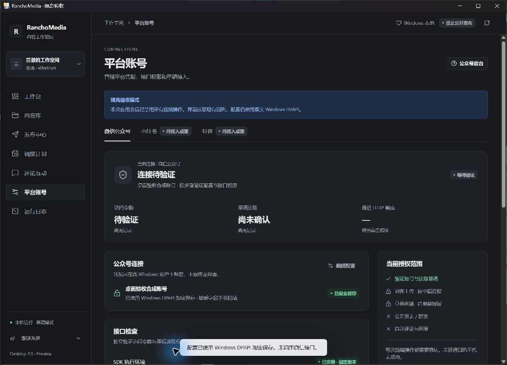
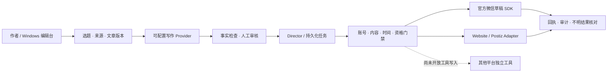

# RanchoMedia

**面向作者的 AI 内容工作空间：研究、写作、版本编辑、人工审核和受控的平台分发。**

[English](README_EN.md) · [平台能力](docs/PLATFORMS.md) · [架构](docs/ARCHITECTURE.md) · [安全](SECURITY.md) · [许可](THIRD_PARTY_NOTICES.md)

当前为开发预览版本。Windows 桌面端、公众号编辑部、持久化任务与安全门禁已有可运行代码；各平台的实现和实测程度不同，**不代表已经具备全平台无人值守发布能力**。默认不携带账号授权，不启用公开发布。



*真实 Windows 客户端截图，使用合成验收账号；远端操作关闭。不是平台认证或发布成功证明。*

## 已实现

- Windows 桌面 Shell：React/TypeScript、WebView2/Python 宿主、深浅/系统主题、公众号设置、Windows DPAPI 凭据保存、窄 IPC、执行状态与回执。
- 作者编辑台：人工选题/来源、研究笔记、初稿、事实门禁、版本差异、可解释风格反馈、人工审核、Markdown/素材清单导出。
- 写作入口：Mock 离线闭环、已有 Codex 内容包导入、受支持的 `codex exec` 有界长文与审稿流程，以及可选 OpenAI-compatible/Ollama Provider。没有密钥或 Codex 授权时不会伪报真实生成成功。
- Director：复用编辑台的任务表，管理内容变体、排期、暂停、账户/内容授权、限流、重试上限和不明结果核对。平台工作器通过独立 Adapter/外部工具连接，**不是六个已完成资格验证的常驻自主 Agent**。
- RanchoMediaOS：任务/审核/审计协议、SQLite 本地开发、资格登记、幂等账本、Mock、真实本地 Git WebsiteAdapter、Postiz HTTP 包装与契约测试。

## 平台状态（2026-10-29）

| 平台 | 代码/接入 | 已有真实执行证据 | 尚未验收 |
|---|---|---|---|
| 微信公众号 | 官方草稿 API 包装、DPAPI 设置、单次 token/权限检查、封面/draft.add/get 流程 | token 获取成功、草稿列表只读成功；新 token 后需重新探测权限 | 草稿写入未实测；**公开发表/群发未启用** |
| 小红书 | 图文变体、工具资格登记、外部 xiaohongshu-mcp 候选 | 官方创作者 Web UI 单次受监督发布，独立详情及空评论区读取 | MCP/API 会话未认证；Director 工具发布和无人值守未验 |
| 抖音 | 视频变体、素材渲染脚本、SAU 候选 | 官方创作者 Web UI 单次受监督发布，独立视频页及空评论区读取 | SAU/API 会话未认证；Director 工具发布和无人值守未验 |
| 个人网站 | 本地 Git Adapter、限定单稿 GitHub Pages canary、远端核验 | 单篇授权 push、部署回执、公开页面 HTTP/正文核验 | 通用站点生产接入和持续运营 |
| X | 内容线程变体、Postiz CLI/HTTP 候选 | 本地工具/模拟契约 | OAuth、真实发布、评论/回复 |
| 知乎 | 文章变体、官方 ZhihuSync 格式校验候选 | 官方本地 validator | 账号/远端发布；完整上游许可文本未核定，不 vendor |
| Bilibili | 视频变体、SAU/官方开放平台候选 | 本地 CLI 帮助 | 账号、上传、视频 ID、评论 |
| 微信视频号 / YouTube | 上游能力研究、OS 预留目录 | 无平台资格回执 | 未实现已认证的 Rancho 发布 Adapter |

空评论区读取不等于真实入站评论或回复闭环；小红书/抖音匿名可见性未验。公开源码不包含原账号的 Cookie、会话或授权。详见 [逐动作矩阵](docs/PLATFORMS.md)。

## 仓库结构

```text
RanchoMedia/
  RanchoMediaOS/                  # 通用基础设施、协议、Adapter、测试
  RanchoMedia-WeChatPlatform/      # 编辑台、Director、平台包装器、桌面端
    desktop/                      # React + TypeScript
    src/rancho_wechat/             # Python 业务与原生宿主
  integrations/upstreams.json     # 外部项目固定版本；不复制上游实现
  docs/                           # 当前公开文档、来源映射、验证摘要
  scripts/                        # 安全检查、验证、可选依赖准备
  tests/                          # 公开分发边界测试
  .github/workflows/ci.yml
  LICENSE / NOTICE / THIRD_PARTY_NOTICES.md
```

保留两个现有模块名称和内部布局，避免为目录统一重写正常运行的逻辑。原 Git 历史留在原本地仓库；本仓库采用干净源码快照，来源 SHA/原文件哈希及公开修改记录见 [SOURCE_PROVENANCE.json](docs/SOURCE_PROVENANCE.json)。没有源码 gitlink，也不要求递归检出第三方项目。



## Windows 安装与本地启动

需要 Python 3.12、Git、Node.js（桌面前端；本地验证使用 25.2.1）、npm，以及已安装的 Windows WebView2。离线内容闭环不依赖 Docker、PostgreSQL、Temporal、Postiz、平台账号或模型 API。

```powershell
git clone https://github.com/RanchoTao/RanchoMedia.git
cd RanchoMedia
py -3.12 -m venv .venv
.\.venv\Scripts\python.exe -m pip install -r requirements-dev.lock
.\.venv\Scripts\python.exe -m pip install --no-deps -e .\RanchoMediaOS -e .\RanchoMedia-WeChatPlatform
cd RanchoMedia-WeChatPlatform\desktop
npm ci
npm run build
cd ..
..\.venv\Scripts\python.exe -m rancho_wechat.desktop --workspace .
```

最后一条命令在 `RanchoMedia-WeChatPlatform` 内执行。桌面第一次启动会如实显示未配置账号/缺少 SDK；不会复制发布者的凭据或自动访问平台。也可从根目录运行：

```powershell
.\.venv\Scripts\python.exe -m rancho_wechat.desktop --workspace .\RanchoMedia-WeChatPlatform
```

构建便携 EXE：`powershell -NoProfile -File RanchoMedia-WeChatPlatform/scripts/build_desktop.ps1`。生成目录需整体保留 `_internal`；二进制未签名且依附工作区，未随源码提交。多显示器 DPI 切换和全新机器安装仍需人工验收。

### 不配置账号即可运行的离线示例

```powershell
cd RanchoMedia-WeChatPlatform
$env:WECHAT_PROVIDER = 'mock'
$env:WECHAT_WORK_MODE = 'EDITORIAL_FIRST'
$env:WECHAT_WORKSPACE = '.runtime/v1.1'
..\.venv\Scripts\python.exe -m rancho_wechat.cli demo --out .runtime/demo
..\.venv\Scripts\python.exe -m rancho_wechat.cli serve --port 8767
```

编辑台只绑定本机，CLI 显示本机访问方式。生成的示例明确标记 **MOCK / NOT APPROVED / NOT PUBLISHED**；不当作真实写作验收。所有数据库、令牌和输出在被忽略的 `.runtime` 中。

### 真实写作、编辑与授权

1. 本人合法登录 Codex，准备有来源的 `examples/writing-brief.example.json` 副本；模板内容是合成占位，不能作为事实资料。
2. `WECHAT_PROVIDER=codex-import` 后，使用 `codex-article` 单次生成，或通过 `import-content` 导入当前 Codex 的标准内容包。只有前者属于独立程序化调用。调用次数/超时有界，订阅额度与实际金额不冒充 API 计价。
3. 编辑台查看来源、事实检查、版本差异，作者修改/退稿/批准。`EDITORIAL_FIRST` 进一步禁止批准及对外导出；需要正常编辑/导出时由本人明确改为 `STANDARD`，审核门禁仍保留。
4. 导出批准稿的 Markdown、素材及人工检查表；公众号后台实际导入显示效果仍需作者确认。
5. 需要微信官方草稿接口时，先运行 `scripts/setup_wechat_sdk.ps1`，再在本机 UI 输入并 DPAPI 保存 AppSecret，配置实际出口 IP 白名单，逐次确认凭据检查、权限检查和单稿写入。**没有公开发表或群发入口。**

不要在聊天、Issue、PR 或仓库中提交 Secret、token、Cookie。`.env.example` 只是名称/安全默认值，不自动加载；Provider/平台凭据由进程环境或本机 DPAPI 提供。

## 调度、安全与测试

`network-status`、`network-worker --cycles 1`、`network-pause` 操作已有 Director 队列；`daily`/`schedule` 为本地每日选题任务。它们需要本机持续运行，不代表云端调度已部署。队列不能绕过作者审核、账号/变体授权、单次写入及 UNKNOWN 核对门禁。X/知乎/小红书/抖音/B站工具写入目前被明确拦截。

```powershell
powershell -NoProfile -File scripts/verify.ps1
.\.venv\Scripts\python.exe scripts/check_public_tree.py
```

首次运行验证前先完成上面的 npm 安装。测试仅创建临时合成数据，不登录账号、不发帖。干净环境验收：OS **73 passed**、编辑/平台模块 **192 passed / 1 skipped**、桌面 **12 passed**；完整结果及边界见 [验证摘要](docs/RELEASE_VALIDATION.md)。Git 历史和发布文件另经 Gitleaks 检查，不用测试数量代替安全或平台资格。

## 已知限制与下一步

优先完成一篇稿件的作者内容验收、真实官方微信草稿回查、明确授权平台的工具会话及持续运行恢复；然后逐步将正文编辑/发布中心接入新桌面。PostgreSQL/Temporal/Postiz 真实服务资格仍未完成；本地 SQLite/HTTP 模拟测试不代表这些服务已运行。评论回复、全平台无人值守与生产多用户认证尚未交付。

## 许可证

Rancho 自有源码在所有者明确授权后以 [Apache-2.0](LICENSE) 发布。第三方不重新授权：Postiz AGPL 边界、SAU MIT、XHS MCP Apache-2.0、wechatpy MIT 及未核定组件见 [THIRD_PARTY_NOTICES.md](THIRD_PARTY_NOTICES.md)。代码许可证不授予文章版权、平台账号或自动化操作权限。
