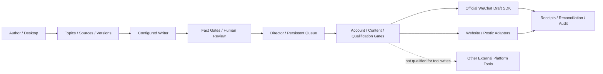

# RanchoMedia

**An AI editorial workspace for research, writing, revision, human review and controlled distribution.**

[中文](README.md) · [Platform matrix](docs/PLATFORMS.md) · [Architecture](docs/ARCHITECTURE.md) · [Security](SECURITY.md)

This is a development preview, not a fully qualified autonomous publishing service. A clone contains no accounts, cookies, production policies, manuscripts or runtime databases. Platform writes are disabled until explicitly authorized and qualified.

## What is implemented

- A Windows desktop shell using React/TypeScript and Python/WebView2, with system/light/dark themes, WeChat settings, current-user DPAPI storage, a narrow native bridge and execution receipts.
- An editorial desk with topics, provenance, research notes, drafts, fact gates, version diffs, explainable style feedback, human review and Markdown/assets export.
- Offline Mock, external Codex content-package import, bounded `codex exec` writing/review, and optional compatible API/Ollama providers. Missing authentication is not represented as a successful real model call.
- A Director using the existing persistent task ledger for variants, scheduling, pause, account/content authorization, rate limits and unknown-outcome reconciliation. Platform workers/adapters are separate integrations, not six fully qualified autonomous agents.
- RanchoMediaOS protocols, audit/idempotency ledgers, SQLite development, a real local Git WebsiteAdapter, Mock, and a Postiz HTTP wrapper tested against simulated HTTP contracts.

## Verified platform scope

| Platform | Observed evidence | Not established |
|---|---|---|
| WeChat Official Accounts | Real token acquisition and read-only draft listing; draft SDK implemented | Remote draft creation has not been accepted; public publishing and mass sending are disabled |
| Xiaohongshu | One supervised official creator-web publication and authenticated detail/empty-comment inspection | MCP/API session authentication and unattended tool publishing |
| Douyin | One supervised official creator-web video publication and detail/empty-comment inspection | SAU/API session authentication and unattended tool publishing |
| Website | One authorized GitHub Pages push, deployment receipt and public body verification | General production onboarding and continuous operation |
| X / Zhihu / Bilibili | Local tools, variants, validators or simulated contracts | Authenticated remote publication and interaction loops |
| WeChat Channels / YouTube | Upstream research and reserved OS directories | Qualified Rancho publishing adapters |

An empty comment list is not an incoming-comment or reply loop. Anonymous visibility for the social canaries was not verified. New tokens require a fresh permission probe. See [the action-level matrix](docs/PLATFORMS.md).

## Layout and provenance

`RanchoMediaOS/` retains the generic infrastructure; `RanchoMedia-WeChatPlatform/` retains the editorial/Director/platform and desktop implementation. `integrations/` contains pinned external references, `scripts/` verification/setup helpers and `docs/` public technical documentation.

The original module histories remain unchanged locally. This repository publishes clean source snapshots with original commit/blob hashes and public changes in [SOURCE_PROVENANCE.json](docs/SOURCE_PROVENANCE.json). Operational reports and private content are deliberately excluded. There are no source gitlinks or required recursive submodules.



## Windows quick start

Requires Python 3.12, Git, Node/npm and Windows WebView2 for the desktop. The local editorial loop needs no Docker, PostgreSQL, Temporal, Postiz, model API or social account. The tested local Node version was 25.2.1.

```powershell
git clone https://github.com/RanchoTao/RanchoMedia.git
cd RanchoMedia
py -3.12 -m venv .venv
.\.venv\Scripts\python.exe -m pip install -r requirements-dev.lock
.\.venv\Scripts\python.exe -m pip install --no-deps -e .\RanchoMediaOS -e .\RanchoMedia-WeChatPlatform
cd RanchoMedia-WeChatPlatform\desktop
npm ci
npm run build
cd ..
..\.venv\Scripts\python.exe -m rancho_wechat.desktop --workspace .
```

The last command runs inside `RanchoMedia-WeChatPlatform`. Alternatively run from the repository root with `.\.venv\Scripts\python.exe -m rancho_wechat.desktop --workspace .\RanchoMedia-WeChatPlatform`.

For an explicitly unapproved offline example, enter the module directory and run:

```powershell
$env:WECHAT_PROVIDER='mock'
$env:WECHAT_WORK_MODE='EDITORIAL_FIRST'
$env:WECHAT_WORKSPACE='.runtime/v1.1'
..\.venv\Scripts\python.exe -m rancho_wechat.cli demo --out .runtime/demo
..\.venv\Scripts\python.exe -m rancho_wechat.cli serve --port 8767
```

This creates fresh synthetic data and a loopback-only editor. It is not real AI/platform acceptance. The CLI provides the local access mechanism. Never commit its token or database.

For real writing, authenticate Codex normally and replace the synthetic brief with authorized primary sources. `codex-article` performs an independent bounded CLI run; `import-content` imports an externally generated package. Keep author edits and approval separate from model output. `EDITORIAL_FIRST` also blocks approval/export; explicitly choosing `STANDARD` preserves normal review gates while enabling the regular workflow.

The optional `scripts/setup_wechat_sdk.ps1` installs the pinned SDK in an isolated environment without account requests. Use the settings UI for local DPAPI credential input, IP whitelist guidance, individual checks and a separately confirmed draft operation. It has no public-publish/mass-send command.

## Verification and limits

Run `powershell -NoProfile -File scripts/verify.ps1` after installation, and `python scripts/check_public_tree.py` before contributing. Clean Windows validation: OS 73 passing tests, editorial/platform 192 passing with one skipped test, and 12 desktop tests. These use temporary synthetic fixtures. See [release validation](docs/RELEASE_VALIDATION.md), including full-history Gitleaks screening.

The portable desktop build remains unsigned and workspace-dependent. Multi-monitor DPI transitions need human acceptance. Other desktop pages are read-only/incomplete, PostgreSQL/Temporal/Postiz live qualification remains blocked, and platform access, unattended operation, comments/replies and production multi-user authentication are not generally available.

## License

Original Rancho source is [Apache-2.0](LICENSE), explicitly authorized by the owner. External projects retain their own licenses; no Postiz/SAU/MCP application source is vendored. See [THIRD_PARTY_NOTICES.md](THIRD_PARTY_NOTICES.md) for AGPL/MIT/Apache/MPL boundaries and unverified components. The code license does not license imported articles or authorize platform access.
