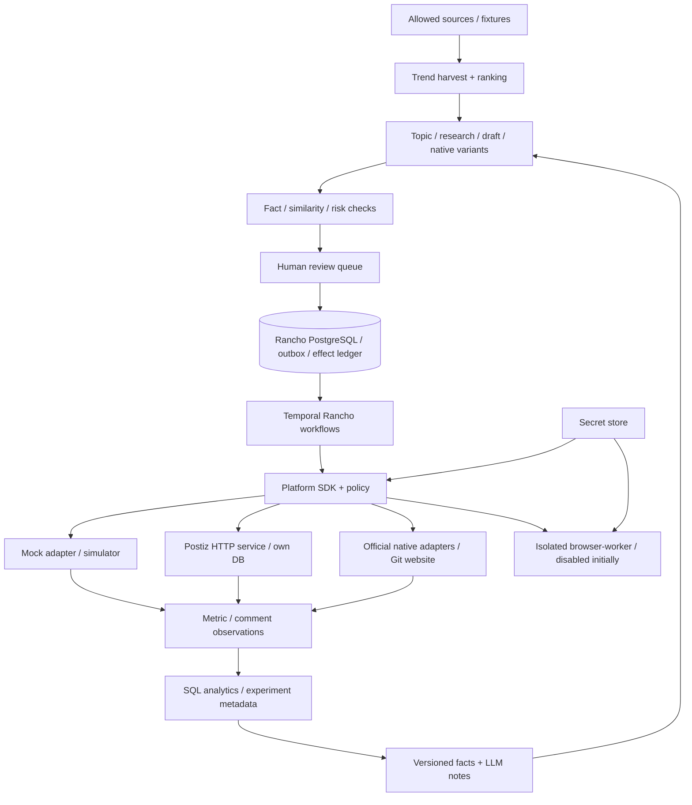

# Rancho Media OS architecture v0.1

工程基线冻结于 2026-09-28，Phase 1 **DESIGN_COMPLETE**。冻结的是接口、数据归属、安全不变量与实施顺序；后续改动记录 ADR，不代表软件已实现、真实平台已授权或验收通过。详细审计见 [Postiz](docs/UPSTREAM_AUDIT_POSTIZ.md)、[SAU](docs/UPSTREAM_AUDIT_SOCIAL_AUTO_UPLOAD.md)、[许可](LICENSE_DECISIONS.md)。

## 决策

| ADR | 选择 | 理由 / 后果 |
| --- | --- | --- |
| 001 | Python 3.12 intelligence/core/API/worker；FastAPI/Pydantic；SQLAlchemy/Alembic；PostgreSQL 17 | 统一 analytics 与 Python adapters；Phase 2 锁精确依赖并验证，无依赖 upstream Python runtime |
| 002 | React/TypeScript/Vite web；OpenAPI 生成 client | review、calendar、metrics 显式状态；纯 UI 不持有平台 credentials |
| 003 | Temporal Python SDK；独立 Rancho namespace | Durable timers/signals/replay；独立业务代码，不复制 Postiz workflows；只读 retry 与 mutation 分开 |
| 004 | Modular monolith API + worker；browser-worker 后续独立进程 | package 边界支持扩展，不先做复杂微服务。API 不能启动 browser |
| 005 | Postiz 外部 HTTP adapter；独立数据库 | 替换 Postiz 不影响 Genome、研究与策略；不用其私有表/AGPL core |
| 006 | Official API First，浏览器默认禁用 | 权限未知不是回退授权；browser 有明确账户与功能资格门槛 |
| 007 | LEVEL 2；revision-bound review；外部动作仅执行 service 可调用 | Agent 产出提案，不能持有发布凭证或调用写工具 |
| 008 | DB ledger + outbox + stable key + unknown reconciliation | Temporal retry 不能保障外部 exactly-once；不透明失败不得重新 publish |
| 009 | immutable Genome/revision、append-only snapshots；SQL 决定 quantitative facts | 形成可追溯 content-performance dataset，LLM 不生成测量值 |
| 010 | Mock adapters + deterministic model fixtures；真实 LLM 验证另列 | 无凭证可开发闭环，但 fixture 不宣称真实 AI topic/writing 已验证 |

## 组件与边界

Rancho 是 content、reference、Genome、review、schedule intent、publication correlation、metrics、comments、experiment、strategy 的权威。Postiz 是连接账号、provider 执行、内部排程/处理状态的权威；不得把其 acceptance 当作公开发布完成。浏览器只执行已审核的一次任务，返回证据；它不选题、不拥有 strategy。

目录按用户指定建立，见 [Repository layout](docs/REPOSITORY_LAYOUT.md)。Python import 使用 `rancho_*` 名，目录 `platform-sdk` 仅布局名，Phase 2 建 packages 的 pyproject；不通过 sys.path 导入 upstream。web 仅引用生成的契约，业务规则由 core 实施。

## 最小闭环与状态机

TrendItem → Idea → research sources/claim evidence → Brief → canonical Draft + Genome → Critic → 原生 variant + immutable Genome → fact/similarity/risk review → Ready for Review → 人工 Approve → Schedule → Mock publish → metrics observations → SQL outcomes → facts + strategy notes → 下一轮 recommendation。

内容状态：DRAFT → READY_FOR_REVIEW → APPROVED →（publication job）SCHEDULED → DISPATCHING → ACCEPTED/PROCESSING → PUBLISHED。补充分支：REJECTED、BLOCKED、FAILED、NEEDS_ATTENTION、OUTCOME_UNKNOWN、NEEDS_HUMAN。文章内容状态和每个账号发布状态分开，一篇内容可多平台异步完成。

`APPROVED` 绑定 variant revision、payload hash、Genome id、references/check results、platform/account/visibility、审批者、policy version。Edit/Regenerate 或配置改变生成新 revision，立即撤销旧审批。最终 adapter payload 先生成供 preview/review，排程后发同一字节语义的 payload；dispatch 前重验审批/hash、secret/scopes、账户状态、风险与取消状态。Publish Now 不能绕过这些检查。UI 明示 mock/test，不把 fixture review 自动批准混入人工审批记录。

## 平台 SDK 契约（设计）

每个 adapter 暴露 authenticate、health_check、publish、schedule、delete、update、fetch_post、fetch_metrics、fetch_comments、reply_comment、search、trends。未实现可继承统一方法返回结构化 `CapabilityError`，不能返回空列表冒充成功。

Capabilities 为操作级描述：支持状态 SUPPORTED/UNSUPPORTED/UNKNOWN/DISABLED，格式集合、scope、limit、schedule_mode NONE/SERVICE/NATIVE、metric_fields、pagination、webhook_types、idempotency_mode NATIVE_KEY/RECONCILE/NO_SAFE_RETRY。每个账号 effective capability = adapter 支持 ∩ 当前权限 ∩ policy；示例 publishing/scheduling/metrics/comments/reply/search/trends bool 为派生视图，不能取代操作级契约。

所有 side-effect 请求有 account_id、operation_id、idempotency_key、approved_revision_id、payload_hash、trace_context、deadline；返回 remote_id/url、ACCEPTED/PROCESSING/PUBLISHED/OUTCOME_UNKNOWN、observed_at、raw_evidence_ref。fetch_post 返回平台查到的状态，不能用 Rancho DB 本地记录冒充外部查询。metrics 每字段有 value/unit/scope/window/status；缺失是 null+reason。评论分页 cursor、parent_external_id 与更新时间必须保留。

错误：CapabilityError、ValidationError、AuthenticationRequired、PermissionDenied、RateLimited(retry_after)、TransientReadError、PermanentError、NeedsHuman、OutcomeUnknown。网络 mutation timeout 归 OutcomeUnknown，不能归普通 transient。health_check 只读，不通过真实 publish 探活。

## 可靠性不变量

- job UNIQUE(owner_id,idempotency_key)；payload hash 与稳定 key 一一绑定；同 key 不同 payload 返回 conflict。对 reply/delete 同样采用 effect ledger。每个发布分片/线程元素/媒体最终提交有独立子 key，避免半成功线程重跑。
- 事务内落 job、audit、outbox；outbox dispatcher 用 job_id 派生 workflow_id，重复开始复用同一个 workflow；DB 与 Temporal 非同一事务，由 outbox 和 reconcile 保证交付。
- effect ledger PREPARED → IN_FLIGHT → CONFIRMED。恢复时 IN_FLIGHT/expired lease 都是 UNKNOWN；凭 lease 过期不能再次发送。锁/唯一键只防本地并发，不关闭外部平台与 DB 之间的崩溃窗口。
- 支持原生 key 时 retry 同 key；否则先外部结果查询/证明未提交，再继续。无核对能力的 timeout 进入 NEEDS_ATTENTION，人工检查。测试中 provider mock 的稳定 key 持久去重，不在进程内字典做假幂等。
- Postiz 未发现公开 create idempotency key：timeout 不重新 POST。保存内部 id/外部 id/correlation，查询核对；不能确定就人工。真实模式资格未通过时 disabled。Postiz 管理页手工绕开 Rancho 属单独活动，不可宣称由 Rancho policy 控制。
- Cancel 在 IN_FLIGHT 时返回 TOO_LATE/UNKNOWN，并核对；停止 workflow 不是撤销平台已接受动作。已发 delete/update 需要独立审批与 capability。

## Workflow 与排程

CreateContentWorkflow、PublishContentWorkflow、MetricsObservationWorkflow、CommentMonitoringWorkflow、TrendHarvestWorkflow、StrategyUpdateWorkflow，明确 activity/retry/恢复设计见 [MVP](docs/MVP_PLAN.md)。所有 provider/LLM/DB IO 放 activities；workflow 只做可 replay 的决策/Temporal timers/signals。代码版本登记，已跑 workflow 有版本化迁移，不热替换旧逻辑。

Rancho scheduler 决定时间；Postiz 初期在 due time 接收一次立即发布请求，减少双 scheduler。若后续委托 Postiz schedule，DB 记录 delegation，Rancho 仅追踪，不再次到点发；native publishAt 同理。全部 timestamptz UTC，UI Asia/Shanghai，保存用户原 timezone，平台限制与 deadline 前置校验。

metric offsets 从**实际平台 published_at**锚定，T+10m/1h/6h/24h/72h/7d/30d，不从 draft/schedule/acceptance 起算。空数据/延迟不能推进假 snapshot。comment workflow 初期只采集/分类/建议，不自动回复。

## 安全、扩展与可观测

[Security](docs/SECURITY_MODEL.md)、[Autonomy](docs/AUTONOMY_POLICY.md) 为执行规范。Credential 只存 secret_ref；平台 secrets 不进 DB/Temporal arguments/history/logs/prompt。Postiz 自托管 token 安全是单独阻塞，mock 不依赖它。账户刷新/撤权、来源 prompt injection、SSRF、MDX 任意代码风险均 fail closed。

统一 traces：run_id、workflow_id、agent、adapter、operation、API route、platform/account、content/variant/publication id、code_sha、prompt/model/policy/strategy version、started_at/finished_at/status/error_code/retry_count；全链路可查。Audit append-only、观众内容和证据设 retention，日志不含 payload secrets。每个动作包括失败与拒绝均有 trace。

单 DB 按 owner/platform/account/publication/time 建索引；metric append-only，可达规模后按观测月份分区；embedding 可后加 pgvector（model/dimension/version 作为 schema 元数据）。先 manual A/B metadata，no RL。需要扩展只替换 adapter或拆 worker，不改变历史 Genome 与观测事实。真实来源采集优先一个 RSS/HN；大型爬取不在 MVP。
