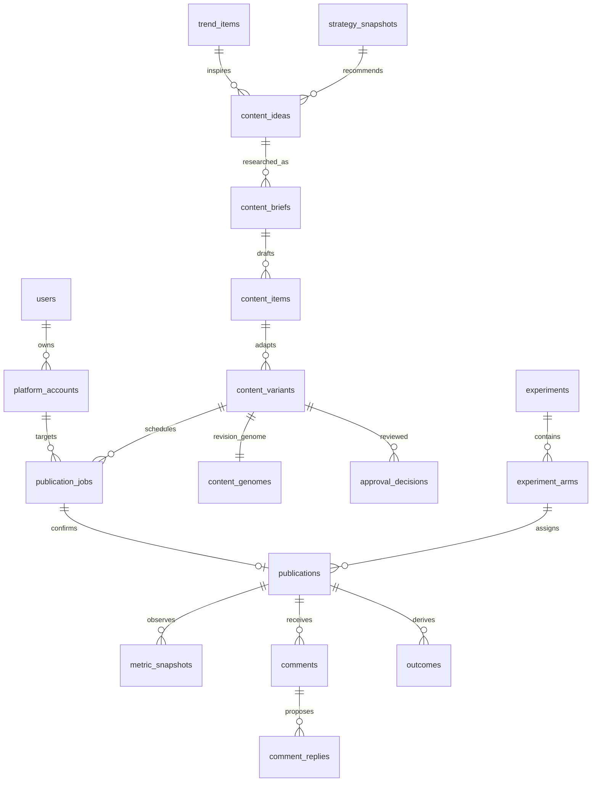

# Data model v0.1

Phase 1 设计基线；**没有已执行 migration 或 DB 测试**。PostgreSQL 17，SQLAlchemy/Alembic 实现于 Phase 2。各业务表 UUID id、owner_id、created_at timestamptz UTC；mutable 表有 updated_at/revision。下面明确列出额外关键列、关系与约束。FK 默认 RESTRICT；不级联删除观测、审批或 audit。JSONB 只能用在 provider 扩展/已版本化结构，不能以无 schema 的 blob 代替索引/关键 FK。

## 关系

content_variant 是**不可变的一次版本**，同逻辑 variant 通过 variant_group_id+revision 链接；canonical item revision 也是不可变。canonical 有 canonical Genome，platform variant 有自己的 Genome；每份生成内容都必须有对应 Genome，而不是发布时补填。UI 显示的内容/审批/发布 hash 必须指向同 revision。

## 必需表

| Table | 关键字段（除公共字段） | 关系 / 约束 |
| --- | --- | --- |
| users | identity_subject, display_name, role, disabled_at | UNIQUE(identity_subject)；单所有者 MVP，后续组织 memberships 单独迁移 |
| platform_accounts | platform, provider_identifier, external_account_id, postiz_integration_id, account_type, timezone, follower_count nullable, status, capability_version, effective_capabilities, last_health_at | UNIQUE(owner_id,platform,external_account_id)；external IDs text；member/page 区分 |
| platform_credentials | account_id, secret_ref, kind, scopes, expires_at, key_version, rotated_at, revoked_at | FK account；只 metadata/ref，无 token/cookie 明文；secret material 不在此表 |
| trend_items | platform, external_id, url, title, text, author, detected_at, published_at nullable, views/likes/comments/shares nullable, rank nullable, velocity nullable, topic_embedding_ref nullable, raw_payload_ref, source_id, trust_status | UNIQUE(owner_id,source_id,external_id)；重抓 update detected/观察历史另表，不能换掉初次发现时间 |
| sources | source_type, canonical_url, title, author, published_at, retrieved_at, content_hash, license_status, trust_status, excerpt_ref, retention_until | UNIQUE(owner_id,content_hash)；原文存受控引用，prompt injection 不当指令 |
| content_ideas | trend_id nullable, topic, angle, relevance_components, score_version, originating_strategy_id nullable, status | FK trend/strategy；评分 components 可追溯 |
| content_briefs | idea_id, revision, target_audience, intent, claim_ids, structure, reference_ids, output_schema_version | UNIQUE(idea_id,revision)；研究证据完成后才能生成可发布主张 |
| content_items | brief_id, content_group_id, revision, canonical_body_ref, body_hash, canonical_genome_id, previous_revision_id, format, status | UNIQUE(content_group_id,revision)；content_genomes 的反向绑定用 DEFERRABLE FK / 一事务创建；不先留永久 orphan |
| content_variants | item_id, variant_group_id, revision, previous_revision_id, platform, account_id, title, body_ref, payload_hash, format, status, genome_id, adapter_schema_version | UNIQUE(variant_group_id,revision)；genome_id NOT NULL UNIQUE；平台变体不得重新覆盖旧行 |
| content_genomes | genome_schema_version, topic, subtopic, angle, claim, hook, format, platform, tone, length, technical_depth, novelty, visual_style, cta, trend_source_ids, reference_ids, planned_publish_at nullable, model, prompt_version, strategy_version, model_call_id nullable, provenance_kind | 不可变；depth/novelty CHECK 0..1；source/ref 用关联表维护 FK；actual publish_time 在 publications，不改 genome |
| media_assets | sha256, object_ref, mime, size_bytes, duration_seconds nullable, width/height nullable, license_status, scan_status, created_by_run_id | UNIQUE(owner_id,sha256)；未通过权益/mime/扫描不可审批；variants via variant_media |
| publication_jobs | variant_id, account_id, approved_decision_id, scheduled_at, original_timezone, status, operation_id, idempotency_key, payload_hash, workflow_id, delegation_mode, remote_job_id nullable, cancel_requested_at nullable | UNIQUE(owner_id,idempotency_key)；UNIQUE(owner_id,operation_id)；复用 key 不同 payload 409；FK approval+exact revision |
| publications | job_id, account_id, variant_id, genome_id, external_id, url, status, accepted_at nullable, published_at nullable, observed_at, evidence_ref, experiment_arm_id nullable, simulation | UNIQUE(job_id)；partial UNIQUE(account_id,external_id) 非 null；已确认 published_at 来自平台证据 |
| metric_snapshots | publication_id, observation_id, target_offset_seconds, observed_at, source_window_start/end, metric_schema_version, metrics_json, raw_payload_ref, collector_version, simulation, status | UNIQUE(publication_id,observation_id)；每字段 value/unit/scope/window/availability；append-only |
| comments | publication_id, external_id, parent_external_id nullable, author_pseudonym, text_ref, text_hash, platform_created_at, platform_updated_at, observed_at, classification, classification_confidence, privacy_flag, status | UNIQUE(account_id,external_id)（保存 account_id）；分页去重，编辑创建 comment_revisions，PII retention |
| comment_replies | comment_id, revision, body_ref, body_hash, classification, confidence, review_status, approval_decision_id nullable, effect_operation_id nullable, external_id nullable, sent_at nullable | 默认提案；真实发出须当前 approval+policy+capability；UNIQUE(effect_operation_id) |
| experiments | name, hypothesis, assignment_unit, eligibility_spec, primary_metric, age_bucket, reward_version, start_at, end_at nullable, status | MVP 手工 metadata；不可事后把 primary metric 改为赢家指标 |
| experiment_arms | experiment_id, name, treatment_spec, assignment_method, intended_sample_size nullable | UNIQUE(experiment_id,name)；不把非随机平台对比称因果 A/B |
| style_signatures | mechanism_schema_version, hook_type, title_pattern, structure, tone, sentence_length, technical_depth, image_count, cta_type, source_ids, extracted_by_run_id | 存机制抽象，禁止原文模板；source FK 用 style_sources |
| strategy_snapshots | version, parent_version nullable, data_cutoff_at, quantitative_facts_ref, query_version, cohort_spec, llm_notes_ref nullable, status, proposed_experiment_ids, simulation | UNIQUE(owner_id,version)；append-only；facts 与 notes 分开；human promote，不自动覆盖 |
| agent_runs | run_id, agent_name, workflow_run_id, input_refs, output_refs, prompt_version, started_at, finished_at, status, error_code, code_sha, simulation | 输入引用与输出类型化；agent 无凭证字段 |
| model_calls | agent_run_id, provider, model, prompt_version, input_tokens nullable, output_tokens nullable, latency_ms, estimated_cost nullable, currency nullable, pricing_version nullable, operation, status, simulation | cache/fixture 不冒称真实 tokens/cost；失败与重试每次独立记录 |
| workflow_runs | workflow_id, temporal_run_id, workflow_type, logical_operation_id, code_sha, started_at, finished_at, status, error_code, retry_count | UNIQUE(workflow_id,temporal_run_id)；同业务 job 可 continue-as-new，保留关联 |
| audit_logs | sequence, actor_id/type, action, resource_type/id, before_ref/after_ref nullable, result, policy_version, trace_id, code_sha, created_at | append-only DB role；无 secret 值；包含拒绝/取消/编辑/批准与 unknown |

## 为正确性增加的表

| Table | 字段 / 规则 |
| --- | --- |
| approval_decisions | variant_id OR reply_id（XOR）、revision_hash、payload_hash、account_id、policy_version、reviewer_id、decision、reason、created_at、invalidated_at；有效 approval 必须与当前内容 hash 和目标一致 |
| quality_checks | variant_id、check_type、algorithm/model/version、source_ids、status PASS/BLOCK/UNKNOWN、score nullable、threshold_version、evidence_ref；fact/semantic 不可用即 UNKNOWN，不以“没有错”当 PASS |
| claim_evidence | claim_id、item/brief id、source_id、source_excerpt_ref、entailment_status、reviewer_id、checked_at；具体主张可映射来源 |
| side_effect_operations | operation_id、kind PUBLISH/REPLY/DELETE/UPDATE、account_id、idempotency_key、payload_hash、status PREPARED/IN_FLIGHT/CONFIRMED/UNKNOWN/FAILED、remote_id、lease_owner/expires_at、last_attempt_at、evidence_ref；UNIQUE(owner_id,idempotency_key) |
| side_effect_attempts | operation_id、attempt_no、started_at、finished_at、request_hash、error_code、outcome、remote_request_id、trace_id；UNIQUE(operation_id,attempt_no)；不存 authorization |
| outbox_events | event_id、aggregate_id/version、event_type、payload_refs、created_at、delivered_at、attempt_count；UNIQUE(aggregate_id,version,event_type)；delivered 不等于发布成功 |
| metric_observations | publication_id、target_offset_seconds、scheduled_for、status、attempt_count、last_error、completed_snapshot_id；UNIQUE(publication_id,target_offset_seconds)；读取 retry 不制造多份同目标 snapshot |
| outcomes | publication_id、metric_snapshot_id、derivation_version、cohort/baseline_version、rates、reward nullable、coverage、z_score/percentile/relative_lift nullable、status；append-only，UNIQUE(snapshot_id,derivation_version,baseline_version) |
| baseline_versions | version、metric definition、cohort spec、window cutoff、sample_n、mean/std/quantiles、query_hash、simulation；数据截止与评估 cohort 分离 |
| trend_observations | trend_id、observed_at、counts nullable、availability；计算 velocity 有至少两次同范围观察 |
| account_health_events | account_id、observed_at、status、capability_version、error_code；只读健康检查与撤权证据 |
| inbox_events | origin、external_event_id、payload_ref、received_at、auth_status、processed_at；UNIQUE(origin,external_event_id)；unsigned Postiz webhook 非权威，触发 read reconciliation |
| content_sources / genome_sources / style_sources / variant_media | 明确 owner-scoped FK junction；每对 FK UNIQUE，来源类型与用途可追溯 |

## 事务与隔离

1. 生成 canonical/variant/Genome/checks 为一事务；失败不留可审批半成品。
2. 审批检查 revision/hash 与 optimistic version；排程同事务验证 approval，插入 job/effect ledger/outbox/audit；不能先排程后再补审批。
3. worker 每次 dispatch 在 owner/account 权限下锁 operation，验证 approval 的当前有效性；提交 IN_FLIGHT 后才发送外部请求。网络 IO 不占长 DB transaction；UNKNOWN 崩溃窗口通过只读核对处理。
4. 抓 metrics 保存 snapshot+observation completion+audit 同事务，UNIQUE 去重；分析只读 snapshot、写 immutable outcome/strategy version。
5. 所有 owner FK 检查一致性：使用 `(owner_id,id)` composite unique 与 composite FK；不是仅在 UI 加 owner filter。Postgres RLS 可二阶段强化，MVP API/service 必须有 owner scope 与跨 owner negative tests。
6. UI 无 token 查询权限；DB runtime roles 分 API/worker/analytics，analytics 对测量数据只读；append-only 表禁止常规 UPDATE/DELETE，隐私删除通过专用 audited retention job处理。

## 索引与保留

job(owner_id,status,scheduled_at)、publication(account_id,published_at)、snapshot(publication_id,observed_at)、comment(publication_id,platform_created_at)、trend(source_id,detected_at)、outbox(delivered_at,created_at)、effect(account_id,status)、audit(owner_id,sequence)。内容计数非负；timestamptz、bytes bigint；货币 numeric，tokens bigint nullable。无数据与真实零值不同。

内容/源/截图 raw payload 使用 object_ref+hash+retention，JSON raw payload 经过 secret/PII scrubbing 再存；不同意将整份 cookie/browser DOM 放普通 DB。pgvector 暂不开启：embedding_ref 记录 model/dimension/version，后续迁移才加入 vector column。发布记录与 Genome 长期保留；观众 PII 与原文按明确政策缩短保留，访问与删除可审计。
